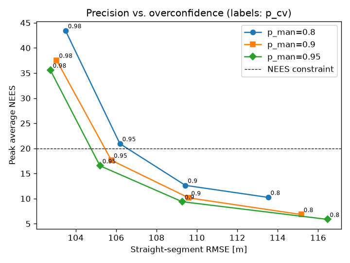
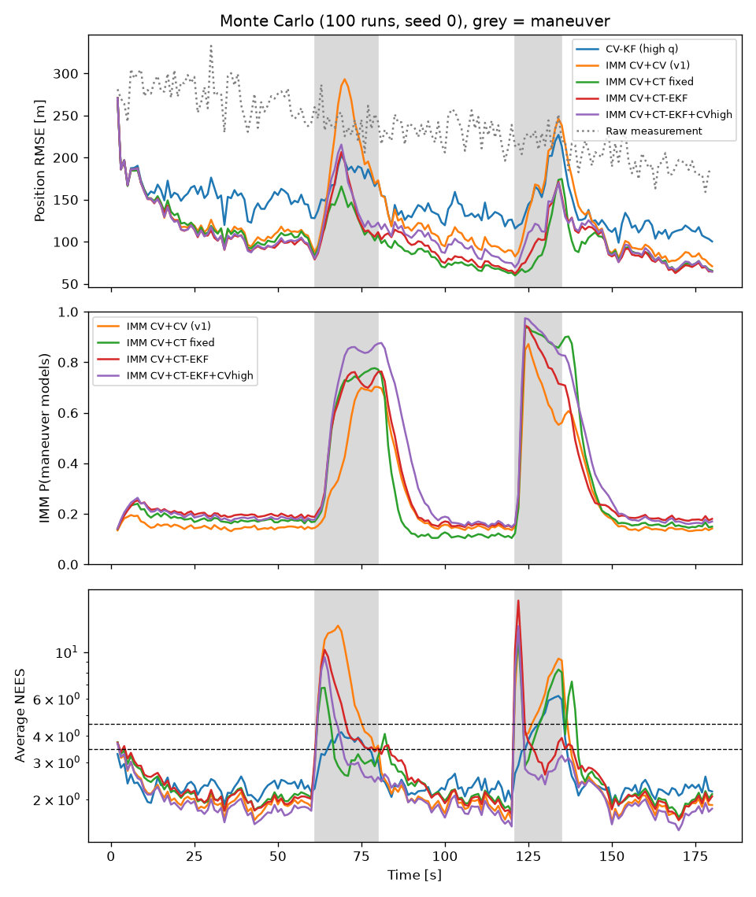
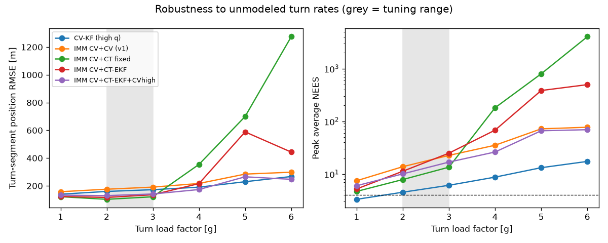

# 프로젝트 1. 기동 표적에 대한 레이더 추적 필터 비교 (KF → IMM → 선회 모델 IMM)

## 요약
| 버전 | 질문 | 결론 |
|---|---|---|
| v1 | 단일 KF와 IMM(CV+CV)은 어떻게 다른가? | IMM이 직진 구간에서 16% 낫지만, **선회 구간에서는 오히려 나쁘고 과신 구간이 생김** |
| v2 | 선회(CT) 모델을 넣으면 해결되는가? | 설계 범위(2~3g)에서는 선회 구간 오차 **-39%**. 하지만 **4g 이상에서는 붕괴** |
| v2.1 | 설계 범위 밖에서도 버티게 하려면? | high-q CV 예비 모델을 추가. 공칭 성능은 4% 손해, **6g 오차는 443 m → 247 m** |

버전별 상세 기록은 [CHANGELOG](../CHANGELOG.md#프로젝트-1-레이더-추적-필터)에 있습니다.

## 문제 정의
레이더 추적 필터는 직진 구간에서는 잡음을 최대한 줄여야 하고, 표적이 급선회할 때는 표적을 놓치지 않아야 합니다.
이 트레이드오프를 몬테카를로 실험으로 정량화하고, 모델 구성에 따라 **정확도(RMSE)**, **일관성(NEES)**,
**설계 범위 밖 강건성**이 어떻게 달라지는지 검증합니다.

## 시나리오 (합성 데이터)
- 레이더: 원점에 위치, 거리 σ = 30 m, 방위각 σ = 0.2°, 갱신 주기 1 s
- 표적: 250 m/s 항공기, 거리 약 50~85 km
  - 직진 60 s → **2g 좌선회 20 s** → 직진 40 s → **3g 우선회 15 s** → 직진 45 s
- 측정은 극좌표로 생성한 뒤 직교좌표로 변환하고, 선형화 공분산을 사용

## 비교한 필터
| 필터 | 구성 |
|---|---|
| CV-KF (high q) | 등속 모델 1개, 가속도 잡음 σa = 30 m/s² |
| IMM CV+CV (v1) | 저잡음 CV(σa = 1) + 고잡음 CV(σa = 30) |
| IMM CV+CT fixed | 저잡음 CV + 선회율을 ±0.1 rad/s(≈2.5g)로 **가정한** CT 모델 2개 |
| IMM CV+CT-EKF | 저잡음 CV + 선회율 ω를 상태로 **추정하는** CT 모델 (EKF) |
| IMM CV+CT-EKF+CVhigh | 위 구성 + 고잡음 CV 예비 모델 (v2.1, 재튜닝 없음) |

## 실험 방법: 튜닝과 평가 분리
- 파라미터는 [sweep.py](sweep.py)로 **튜닝 시드(100)** 에서만 골랐습니다. 최종 평가는 v1과 같은 **평가 시드(0)** 에서 했습니다.
- **선택 기준: "최대 NEES ≤ 20인 설정 중 전체 RMSE가 가장 낮은 것"**
  - RMSE만 보면 p_cv = 0.98이 가장 좋지만, 이때 최대 NEES가 36~43입니다. 선회 구간에서 필터가 자기 오차를
    크게 과소평가하므로 탈락시켰습니다. 아래 그래프에서 보듯 실제 트레이드오프는 **정밀도 vs 과신**입니다.



## 결과 1: 공칭 시나리오 (100회 몬테카를로, seed 0)

| Filter | Pos RMSE [m] | 직진 | 선회 | 선회 시작 5 s | 최대 RMSE* | Vel RMSE [m/s] | 평균 NEES (이상값 4) | 최대 NEES* |
|---|---|---|---|---|---|---|---|---|
| 원시 측정값 | 239.6 | 240.7 | 234.9 | - | - | - | - | - |
| CV-KF (high q) | 148.4 | 142.0 | 172.3 | 135.8 | 227.0 | 50.5 | 2.6 | 6.2 |
| IMM CV+CV (v1) | 137.1 | 118.9 | 194.6 | 114.6 | 293.2 | 45.9 | 3.1 | 13.3 |
| **IMM CV+CT fixed** | **108.5** | **105.8** | **118.7** | **88.5** | **174.6** | **30.9** | 2.8 | 11.8 |
| IMM CV+CT-EKF | 111.1 | 106.0 | 130.0 | 91.0 | 206.5 | 33.0 | 2.8 | 17.5 |
| IMM CV+CT-EKF+CVhigh | 115.6 | 109.5 | 138.1 | 102.6 | 215.5 | 34.1 | 2.4 | 13.3 |

\* 초기 수렴 구간(처음 10 s)은 제외



**v1 대비 개선 (IMM CV+CT fixed 기준):** 선회 구간 오차 195 → 119 m (**-39%**), 전체 위치 오차 -21%, 속도 오차 -33%.
v1에서 지적한 "선회 시작 지연"도 115 → 89 m로 줄었습니다.

## 결과 2: 설계 범위 밖 강건성 (30회 몬테카를로, 두 선회 모두 같은 g)
필터 파라미터는 그대로 두고, 표적의 선회 g만 1~6g로 바꿨습니다. 각 칸은 선회 구간 RMSE [m] / 최대 NEES입니다.

| Filter | 1g | 2g | 3g | 4g | 5g | 6g |
|---|---|---|---|---|---|---|
| CV-KF (high q) | 140 / 3.3 | 160 / 4.5 | 172 / 6.1 | 190 / 8.8 | 230 / 13.2 | 267 / 17.4 |
| IMM CV+CV (v1) | 158 / 7.5 | 176 / 13.8 | 191 / 22.6 | 217 / 35.2 | 285 / 72.2 | 298 / 77.3 |
| IMM CV+CT fixed | 122 / 4.7 | **103** / 7.9 | **121** / 13.5 | 354 / 181 | 700 / 798 | 1275 / 4037 |
| IMM CV+CT-EKF | 123 / 5.2 | 116 / 11.3 | 136 / 24.9 | 216 / 68.1 | 589 / 385 | 443 / 497 |
| IMM CV+CT-EKF+CVhigh | 133 / 6.0 | 129 / 10.1 | 141 / 16.9 | **173** / 26.2 | 265 / 66.3 | **247** / 69.5 |



## 분석
1. **선회 모델은 설계 범위 안에서 확실히 효과가 있습니다.** 공칭 시나리오의 거의 모든 지표에서 v1보다 좋습니다.
2. **공칭 시나리오 1위(고정 CT)가 설계 범위 밖에서는 꼴찌입니다.** 6g에서 오차가 1.3 km, NEES가 4000을 넘습니다.
   가정한 선회율(2.5g)과 실제가 크게 다르면 어떤 모델도 맞지 않는데, 필터는 여전히 자신만만합니다.
   공칭 시나리오의 결과만 보고 필터를 골랐다면 놓쳤을 위험입니다.
3. **선회율을 추정하는 CT-EKF도 5g 이상에서는 무너집니다.** 선회율 변화를 따라잡는 데 걸리는 시간보다
   오차가 커지는 속도가 더 빠르기 때문입니다.
4. **예비 모델(v2.1)은 보험 역할을 합니다.** 공칭 성능을 4% 내주는 대신 4g 이상에서 최고 또는 그에 가까운 성능을 냅니다.
   체계 관점에서는 평균 성능보다 **최악의 경우를 막는 것**이 보통 더 가치 있습니다.
5. **아직 남은 문제:** 5~6g에서는 v2.1도 최대 NEES가 약 70으로 과신 상태입니다. 단일 high-q KF는 가장 일관성이 높지만(NEES < 18)
   정밀도가 가장 낮습니다. 정밀도와 일관성을 함께 얻는 해법은 아직 찾지 못했습니다.

## 엔지니어링 메모
- **수치 안정성 버그를 발견하고 수정했습니다.** CT 모델의 `1 - cos(ωT)`는 ω가 0에 가까우면 상쇄 오차가 생겨 야코비안이 틀어집니다.
  직진 비행 중 ω 추정치는 늘 0 근처라 실제로 영향을 받는 구간입니다. `2·sin²(ωT/2)`로 바꿨고,
  [test_filters.py](test_filters.py)의 유한차분 야코비안 테스트로 검증했습니다.
- **리팩터링 회귀 검증:** 공통 모듈로 구조를 바꾼 뒤에도 v1 필터 수치(148.4 / 137.1 m)가 그대로 재현되는 것을 확인했습니다.

## 다음 단계
- [ ] 고잡음 예비 모델의 σa와 전이확률을 **강건성 시나리오까지 포함해** 튜닝 (다목적 기준)
- [ ] 큰 기동 구간의 과신을 줄이는 방법 비교: 적응형 공정잡음, 잔차 기반 기동 탐지, UKF
- [ ] 3차원(고각 포함)으로 확장, 클러터와 Pd < 1 환경에서 데이터 연관(PDA/JPDA) 추가
- [ ] 학습 기반 추적기(LSTM/Transformer)와 비교. 일관성(NEES) 보장이 어렵다는 점까지 함께 분석
- [ ] 핵심 루프를 C++로 포팅해 스텝당 처리 시간 측정

## 파일 구성과 실행
| 파일 | 역할 |
|---|---|
| [simulate.py](simulate.py) | 표적 궤적, 레이더 측정 생성 |
| [filters.py](filters.py) | CV / 고정 CT / CT-EKF 모델, KF, IMM |
| [experiment.py](experiment.py) | 공통 설정, 필터 구성, 몬테카를로 루프, 지표 |
| [sweep.py](sweep.py) | 파라미터 튜닝 (튜닝 시드) |
| [run_experiment.py](run_experiment.py) | 최종 평가 (평가 시드) |
| [robustness.py](robustness.py) | 설계 범위 밖 강건성 실험 |
| [test_filters.py](test_filters.py) | 모델 검증 테스트 |

```bash
pip install -r requirements.txt
python test_filters.py
python sweep.py             # 약 2분, results/sweep.md
python run_experiment.py    # results/metrics.md, monte_carlo.png, trajectory.png
python robustness.py        # results/robustness.md, robustness.png
```

## 면접에서 설명할 포인트
- **왜 RMSE만으로는 부족한가?** 필터가 추정한 공분산은 게이팅, 데이터 연관, 교전 판단에 쓰입니다. 과신(NEES ≫ 4)은 표적 상실로 이어집니다.
- **튜닝 시드와 평가 시드를 왜 나눴나?** 같은 데이터로 튜닝하고 평가하면 성능이 과대평가됩니다. ML의 train/test 분리와 같은 원리입니다.
- **공칭 1위 필터를 왜 고르지 않는가?** 설계 범위 밖 시험에서 붕괴했기 때문입니다. 체계 요구사항은 보통 평균보다 최악의 경우로 정의됩니다.
- **딥러닝 대신 IMM을 먼저 한 이유는?** 해석할 수 있고, 검증할 수 있고, 데이터가 적어도 되며, 실패 원인을 추적할 수 있기 때문입니다.
