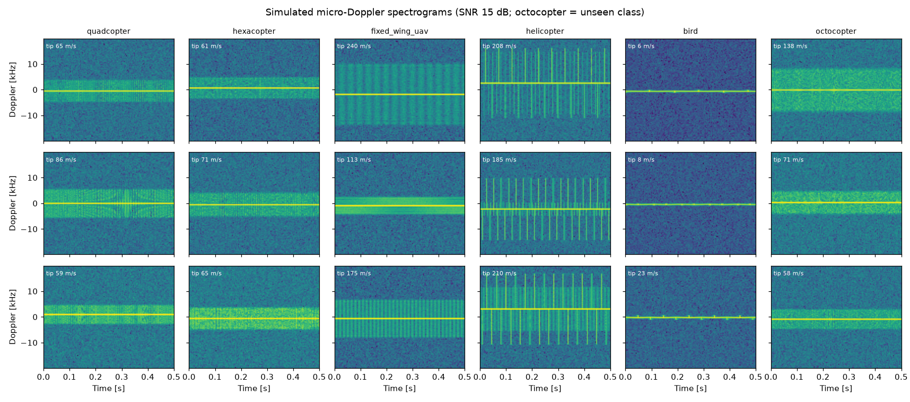
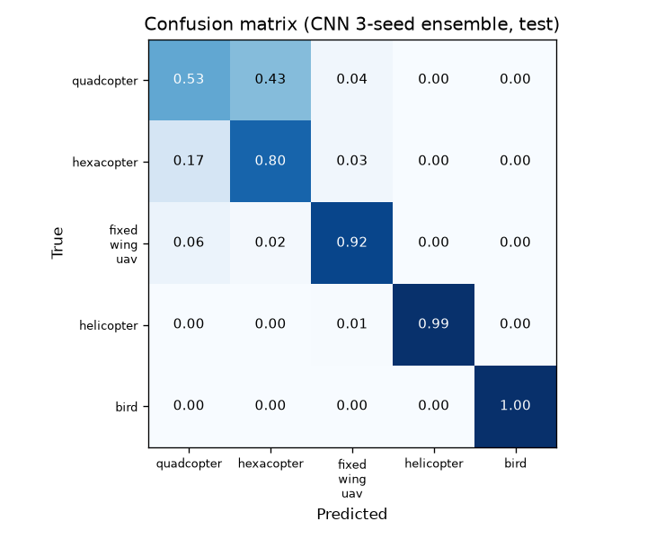
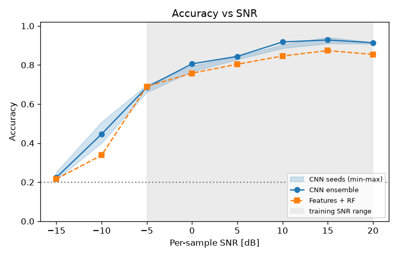
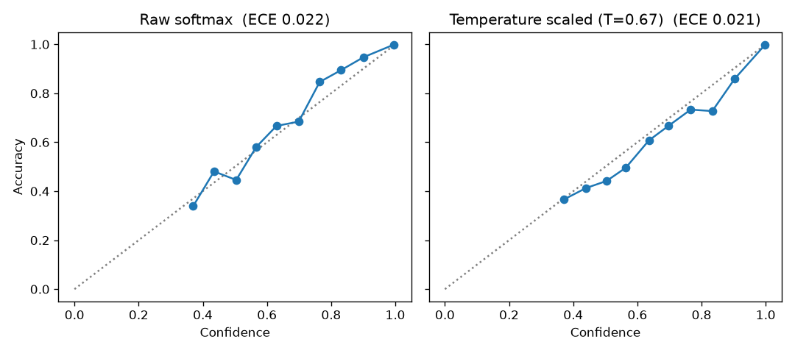
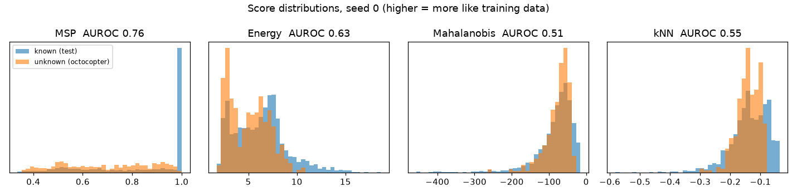
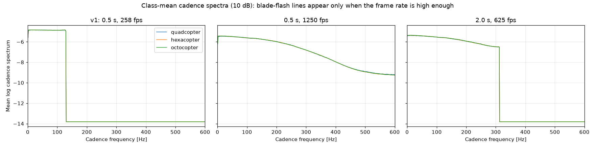
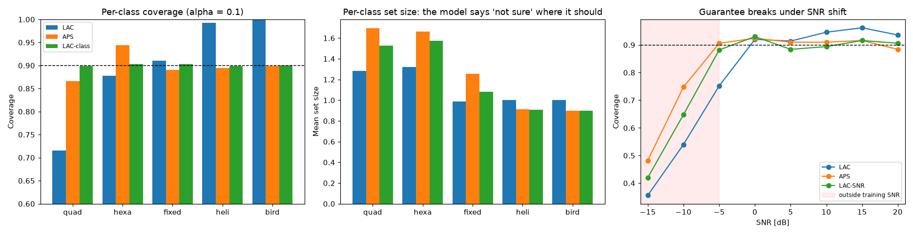
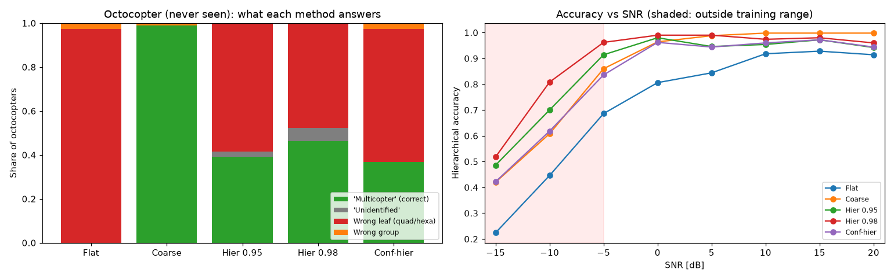

# 프로젝트 2. 마이크로도플러 기반 공중 표적 분류 — 정확도를 넘어 "믿을 수 있는가"까지

## 요약
레이더에 잡힌 표적이 **쿼드콥터 / 헥사콥터 / 고정익 UAV / 헬기 / 조류** 중 무엇인지를
블레이드와 날개의 미세 운동(마이크로도플러) 신호로 분류합니다.
정확도에서 멈추지 않고, 실전 배치에 필요한 일곱 가지 질문을 검증합니다 (v2 표시는 v2에서 추가한 질문).

| 질문 | 검증 방법 | 판정 | 핵심 근거 |
|---|---|---|---|
| 올바른 단서로 맞히는가? | 몸체 속도를 통제한 하위 집합에서 재평가 | 🟢 양호 | 속도 통제 시 CNN −1.6%p, 베이스라인 −3.4%p |
| 먼 표적(약한 신호)에서도 되는가? | 학습 범위 밖 SNR(−15 dB)까지 정확도 곡선 | 🟡 주의 | 0 dB 이상은 CNN 우세, −15 dB에서는 무작위 수준 |
| 확신도를 믿어도 되는가? | ECE, 신뢰도 다이어그램, 온도 스케일링 | 🟢 양호 | ECE 0.020 (베이스라인 0.078) |
| 처음 보는 표적을 "모름"이라고 하는가? | 옥토콥터로 미지 표적 탐지 (4가지 점수) | 🔴 위험 | 최선 AUROC 0.74, 옥토콥터의 85%를 헥사콥터로 판정 |
| 구분 못 하는 표적을 정직하게 답하는가? (v2) | conformal 예측 집합 5종, 클래스별·SNR별 적중률 | 🟡 주의 | 클래스별 보정 + 빈 집합 대체로 모든 클래스 ≥ 0.90 (평균 크기 1.24). 학습 범위 밖 SNR에서는 보장 없음 (−15 dB 0.35~0.48) |
| 처음 보는 표적에게 틀리지 않은 답을 주는가? (v2) | 계층형 출력 ("멀티콥터"까지만 답하기) 4종 | 🟡 주의 | 4그룹 출력은 정확도 0.969, 옥토콥터 99%를 "멀티콥터"로 바르게 답함. 단, 미지 표적이라고 **알아채지는** 못함 |
| 임베디드 장비에서 실시간으로 도는가? | ONNX FP32/INT8, 단일 코어 p99 지연 | 🟢 양호 | INT8 218 KB, 1.72 ms, 정확도 손실 없음 |

**정확도:** CNN 83.5% ± 1.0 (3시드), 앙상블 84.8%, 특징+RF 베이스라인 79.9%.

**가장 중요한 발견:** 미지 표적 탐지는 점수 계산법을 바꿔도 개선되지 않았습니다. 특징 공간 방법(Mahalanobis, kNN)은 오히려 무작위 수준이었습니다.
진단해 보니 CNN 특징에 **로터 개수 정보가 거의 없었습니다** (선형 탐침 49.6%, 무작위 33%).
**미지 표적 탐지는 모델이 학습한 표현의 한계를 넘지 못한다**는 점을 정량적으로 확인한 셈입니다.

**v2의 결론:** 쿼드·헥사콥터를 가를 정보는 신호 자체에 거의 없었습니다 (1단계). 그래서 억지로 맞히지 않고, **모르는 만큼 덜 구체적으로 답하게** 바꿨습니다.
후보 집합(2단계)이나 "멀티콥터" 같은 상위 답(3단계)을 쓰면 정확도가 0.848에서 0.93~0.98로 오르고, 옥토콥터에도 틀리지 않은 답을 줄 수 있습니다.
반면 "처음 보는 표적"이라고 **알아채는 일**은 여전히 풀리지 않았습니다. 모델은 옥토콥터를 진짜 쿼드·헥사콥터보다 오히려 더 확신했습니다.
또 하나의 교훈: 체크포인트 선택에 쓴 val로 기준값을 정하면, 보장 목표를 1~7%p 놓칩니다 (3단계).

### v2 진행 상황 (완료, 태그 `p2-v2`)
| 단계 | 질문 | 상태 | 결과 |
|---|---|---|---|
| 1 | 로터 개수 정보가 입력 신호에 남아 있는가? 입력 설정을 바꾸면 늘어나는가? | ✅ 완료 | 최선 조건에서도 탐침 정확도 0.52 (무작위 0.333, 10 dB). 두 가설 모두 반증 → [결과 8](#8-v2-1단계-로터-개수-정보는-입력에-거의-없다) |
| 2 | 구분이 안 되는 클래스를 "보장된 후보 집합"으로 답할 수 있는가? (conformal 예측 집합) | ✅ 완료 | 90% 적중률 보장 달성, 평균 집합 크기 1.12~1.29. 단, 기본 방법은 쿼드콥터 적중률 0.72. 클래스별 보정 + 빈 집합 대체로 모든 클래스 ≥ 0.90 (크기 1.24) → [결과 9](#9-v2-2단계-conformal-예측-집합-모르면-후보를-여럿-낸다) |
| 3 | 세부 기종 대신 "멀티콥터"로 답하는 계층형 출력이 미지 표적 판정을 개선하는가? | ✅ 완료 | 정확도 0.848 → 0.93~0.98. 옥토콥터에 "멀티콥터"라는 맞는 답을 37~99% 제공. 다만 옥토콥터를 미지 표적으로 알아채지는 못함 → [결과 10](#10-v2-3단계-계층형-출력-모르면-한-단계-위로-답한다) |
| 4 | README 정리, CHANGELOG, 태그 `p2-v2` | ✅ 완료 | — |

### 목차
| 구분 | 바로가기 |
|---|---|
| 배경과 설계 | [문제 정의](#문제-정의와-체계-연관성) · [시뮬레이터](#시뮬레이터) · [데이터셋](#데이터셋) · [방법](#방법) |
| v1 결과 | [1. 주요 지표](#1-주요-지표) · [2. 클래스별 성능](#2-클래스별-성능-멀티콥터끼리의-혼동이-오류의-대부분) · [3. 지름길 학습](#3-지름길-학습-검사-cnn이-몸체-속도에-덜-의존) · [4. SNR 강건성](#4-snr-강건성-학습-범위를-벗어나면-급락) · [5. 보정](#5-보정-원래부터-잘-맞음-온도-스케일링-이득-없음) · [6. 미지 표적](#6-미지-표적-탐지-점수를-바꿔도-해결되지-않음) · [7. 임베디드](#7-임베디드-배포-시드-0-1-스레드-배치-1) |
| v2 결과 | [8. 정보량 진단](#8-v2-1단계-로터-개수-정보는-입력에-거의-없다) · [9. 예측 집합](#9-v2-2단계-conformal-예측-집합-모르면-후보를-여럿-낸다) · [10. 계층형 출력](#10-v2-3단계-계층형-출력-모르면-한-단계-위로-답한다) |
| 정리 | [엔지니어링 메모](#엔지니어링-메모) · [한계와 다음 단계](#한계와-다음-단계) · [파일 구성과 실행](#파일-구성과-실행) · [면접 포인트](#면접에서-설명할-포인트) · [변경 기록](../CHANGELOG.md#프로젝트-2-마이크로도플러-표적-분류) |

## 문제 정의와 체계 연관성
- 레이더 데이터 처리는 **탐지 → 추적 → 식별** 순서로 이어집니다. [프로젝트 1](../project1_radar_tracking/)이 추적, 이 프로젝트가 식별 단계입니다.
- 소형 드론이 주요 위협이 되면서 **새와 드론의 구분**은 방공 레이더의 실제 과제가 되었습니다. 오경보는 운용자를 지치게 하고, 미탐지는 위협 통과로 이어집니다.
- 분류 결과와 확신도는 위협 평가와 교전 우선순위 판단의 입력이 됩니다. 그래서 정확도만큼이나 **과신하지 않는지**가 중요합니다.
- 공개 자료와 합성 데이터만 사용합니다. 실제 체계의 데이터와 파라미터는 다루지 않습니다.

## 시뮬레이터
### 레이더 파라미터
| 항목 | 값 | 비고 |
|---|---|---|
| 반송파 | 10 GHz (X-band), λ = 3 cm | |
| PRF | 40 kHz (복소 샘플링) | 비모호 도플러 ±20 kHz (±300 m/s) |
| 관측 시간 | 0.5 s (20,000 샘플) | 헬기 로터 1회전 이상, 조류 날갯짓 1.5회 이상 |
| STFT | Hann 256점, 128 프레임 | 주파수 2:1 풀링 → 128×128, 312.5 Hz/bin |
| 동적 범위 | 최대값 기준 60 dB | [0, 1]로 정규화 |

### 신호 모델
- **회전익 블레이드:** 강체 막대 모델 (V. C. Chen, *The Micro-Doppler Effect in Radar*).
  블레이드 k의 반사 = L·sinc(x)·exp(−jx), x = (4π/λ)(L/2)cosβ·cos(Ωt + φ₀ + 2πk/N)
- **조류 날개:** 같은 막대 적분을 쓰되, 회전 대신 날갯짓 각 θ(t) = θ₀ + A·sin(2πf·t)를 적용합니다. 몸체 상하 운동(heave)도 넣었습니다.
- **몸체:** 시선 방향 속도에 따른 도플러 편이 2v/λ
- **잡음:** 복소 백색 가우시안. SNR은 STFT 적분 전 샘플당 기준입니다.

### 클래스별 파라미터 (샘플마다 무작위)
| 클래스 | 로터/날개 | 블레이드 길이 | 회전/날갯짓 | 몸체 속도 | MBR* |
|---|---|---|---|---|---|
| 쿼드콥터 | 로터 4개 (2날 80%, 3날 20%), 로터별 ±5% 속도차 | 0.08–0.20 m | 60–130 rev/s | ±15 m/s | −12–0 dB |
| 헥사콥터 | 로터 6개, 그 외 동일 | 〃 | 〃 | 〃 | 〃 |
| 고정익 UAV | 프로펠러 1개 (2–3날) | 0.12–0.35 m | 70–150 rev/s | ±40 m/s | −12– −2 dB |
| 헬기 | 주로터 2–5날 + 테일로터 2/4날 | 4–8 m / 0.5–1.2 m | 날개 끝 속도 180–230 m/s | ±60 m/s | −8–2 dB |
| 조류 | 날개 2개 (날갯짓) | 0.15–0.5 m | 3–12 Hz, 진폭 30–60° | ±20 m/s | −10–0 dB |
| *옥토콥터 (미지)* | 로터 8개, 그 외 멀티콥터와 동일 | | | | |

\* MBR: 마이크로도플러 대 몸체 전력비. 프로펠러 날개 끝 속도는 240 m/s(아음속)로 제한했습니다.



### 시뮬레이터 검증 ([test_simulate.py](test_simulate.py))
| 테스트 | 기준 |
|---|---|
| 최대 도플러 | 스펙트로그램의 점유 대역이 이론값 2·v_tip/λ의 ±8% 이내 |
| 블레이드 플래시 주기 | 짝수 N날 로터는 1회전당 N번 플래시 (마주 보는 날개가 동시에 빛남) |
| SNR 정의 | 신호+잡음 전력 = 1 + 10^(−SNR/10), 오차 5% 이내 |

## 데이터셋
| 분할 | 클래스 | 개수 | 시드 | SNR |
|---|---|---|---|---|
| train | 5종 | 1,000/클래스 | 1 | U(−5, 20) dB |
| val | 5종 | 200/클래스 | 2 | U(−5, 20) dB |
| test | 5종 | 400/클래스 | 3 | U(−5, 20) dB |
| snr_sweep | 5종 | 100/클래스/레벨 × 8레벨 | 4 | −15 ~ 20 dB 고정 |
| ood | 옥토콥터 | 400 | 5 | U(−5, 20) dB |

분할마다 생성 시드를 다르게 해서 같은 파라미터 조합이 여러 분할에 섞이지 않게 했습니다.
스펙트로그램은 uint8로 저장합니다 (0.24 dB 양자화, 약 200 MB).

## 방법
### 베이스라인: 수작업 특징 + 랜덤포레스트 ([features.py](features.py), [baseline.py](baseline.py))
60차원 특징을 씁니다.
- 도플러 확산 (50/90/99% 에너지 대역폭)
- 점유 대역폭
- 마이크로도플러 에너지 비율과 시간 변동
- **CVD(cadence-velocity diagram)** 기반 주기 특징
- 프레임별 스펙트럼 엔트로피
- 몸체선 기준으로 정렬한 평균 도플러 프로파일

분류기는 RandomForest(트리 500개)입니다.

### CNN ([models.py](models.py), [train.py](train.py))
- 4블록 CNN (16-32-64-96 채널, BN, ReLU, MaxPool), 전역 평균 풀링, Dropout 0.3. **파라미터 약 20만 개.**
- 증강 방법:
  - 시간축 순환 이동: 미세 운동은 정상(stationary) 과정이라는 가정에 근거
  - 도플러축 ±4 bin 이동: 약 ±19 m/s의 몸체 속도 변화에 해당
- AdamW + OneCycle 학습률, 20 에폭, 검증 정확도가 가장 높은 체크포인트 저장
- **시드 3개(0, 1, 2)** 로 반복 학습해 평균 ± 표준편차를 보고하고, 3-시드 앙상블도 평가합니다.
- 일부러 쓰지 않은 기법: 보정 분석을 왜곡하지 않도록 label smoothing은 쓰지 않았습니다.

### 평가 프로토콜 ([evaluate.py](evaluate.py))
| 항목 | 방법 |
|---|---|
| 정확도 | 테스트 정확도, macro F1, 클래스별 재현율, 혼동 행렬 |
| 지름길 학습 검사 | 모든 클래스가 존재하는 \|v\| ≤ 15 m/s 하위 집합의 균형 정확도 |
| SNR 강건성 | −15 ~ 20 dB 레벨별 정확도 (학습 범위는 −5 ~ 20 dB) |
| 보정 | ECE(15 bins). 온도 T는 **검증 세트로만** 적합하고 테스트에서 평가 |
| 미지 표적 탐지 | 최대 softmax 확률(MSP)과 energy score로 AUROC, FPR@95TPR 산출. 옥토콥터를 어떤 클래스로 오인하는지도 분석 |
| 배포 | ONNX FP32 내보내기와 수치 일치 확인, onnxruntime 정적 INT8 양자화(QDQ, 채널별, 검증 세트 300개로 보정), 단일 스레드·배치 1의 중앙값과 p99 지연 |

## 결과
모든 수치는 test 2,000개, snr_sweep 4,000개, ood 400개 기준입니다. CNN은 3개 시드의 평균 ± 표준편차입니다.
원본 수치는 [results/metrics.md](results/metrics.md)와 [results/ood.md](results/ood.md)에 있습니다.

### 1. 주요 지표
| 모델 | 테스트 정확도 | Macro F1 | 균형 정확도 (\|v\| ≤ 15 m/s) | ECE |
|---|---|---|---|---|
| CNN (3시드) | **0.835 ± 0.010** | 0.832 ± 0.011 | **0.819 ± 0.016** | **0.020 ± 0.006** |
| CNN 3시드 앙상블 | **0.848** | 0.845 | 0.834 | 0.023 |
| 특징 + RF | 0.799 | 0.803 | 0.765 | 0.078 |

학습 곡선: 세 시드의 최고 검증 정확도는 85.2 / 85.4 / 85.9%였습니다. 초반 높은 학습률 구간에서 검증 성능이 크게 흔들렸다가 후반에 수렴합니다.

### 2. 클래스별 성능: 멀티콥터끼리의 혼동이 오류의 대부분
| 모델 | 쿼드콥터 | 헥사콥터 | 고정익 UAV | 헬기 | 조류 |
|---|---|---|---|---|---|
| CNN 앙상블 | **0.530** | 0.797 | 0.917 | 0.993 | 1.000 |
| 특징 + RF | 0.565 | 0.595 | 0.850 | 0.995 | 0.993 |



- 헬기(블레이드 플래시)와 조류(저속 날갯짓)는 거의 완벽하게 구분합니다.
- **쿼드콥터의 43.5%를 헥사콥터로** 판정합니다. 두 클래스는 블레이드 길이, 회전수, 몸체 속도 범위가 같고 로터 개수만 다릅니다.
  0.5 s 관측과 312.5 Hz 주파수 해상도에서는 로터별 회전수 차이(±5%)로 생기는 선 구조가 잘 분리되지 않는 것으로 보입니다.

### 3. 지름길 학습 검사: CNN이 몸체 속도에 덜 의존
| 모델 | 전체 | \|v\| ≤ 15 m/s | 차이 |
|---|---|---|---|
| CNN (3시드) | 0.835 | 0.819 | −1.6%p |
| 특징 + RF | 0.799 | 0.765 | **−3.4%p** |

속도 범위가 클래스마다 다른 데이터에서 베이스라인은 속도를 더 많이 이용했습니다. CNN은 속도 정보를 빼도 성능 하락이 절반 수준입니다.
다만 하락이 0은 아니므로, CNN도 속도를 일부 이용하고 있습니다.

### 4. SNR 강건성: 학습 범위를 벗어나면 급락
| 모델 | −15 dB | −10 dB | −5 dB | 0 dB | 5 dB | 10 dB | 15 dB | 20 dB |
|---|---|---|---|---|---|---|---|---|
| CNN 앙상블 | 0.224 | 0.446 | 0.686 | 0.806 | 0.844 | 0.918 | 0.928 | 0.914 |
| 특징 + RF | 0.216 | 0.338 | 0.690 | 0.758 | 0.804 | 0.846 | 0.874 | 0.854 |



- 0 dB 이상에서는 CNN이 4~7%p 앞섭니다.
- 학습 범위의 하한인 −5 dB에서는 두 모델이 같고, −15 dB에서는 둘 다 무작위 수준(20%)입니다.
- 탐지 거리 요구사항을 정하려면 **이 곡선이 꺾이는 지점**을 기준으로 삼아야 합니다.

### 5. 보정: 원래부터 잘 맞음, 온도 스케일링 이득 없음


- 보정 전 ECE는 0.020으로 이미 낮고, 고확신 구간에서는 오히려 약간 **과소신**(대각선 위)입니다.
- 검증 세트로 적합한 온도는 T = 0.64–0.70(< 1)이었습니다. 확신도를 높이는 방향이라 중간 구간은 약간 과신 쪽으로 넘어가고, 평균 ECE는 0.020 → 0.021로 그대로였습니다.
- 온도 스케일링은 NLL을 최소화할 뿐 ECE를 직접 줄이지는 않는다는 점이 드러납니다. 베이스라인(랜덤포레스트)의 ECE는 0.078로 4배 나쁩니다.

### 6. 미지 표적 탐지: 점수를 바꿔도 해결되지 않음
| 점수 | 계산 공간 | AUROC | FPR@95TPR |
|---|---|---|---|
| MSP (최대 softmax 확률) | 출력 | **0.739 ± 0.020** | 0.906 ± 0.019 |
| Energy | 출력 | 0.606 ± 0.040 | 0.939 ± 0.028 |
| Mahalanobis | 특징 (96차원) | 0.478 ± 0.029 | 0.978 ± 0.001 |
| kNN (k = 50) | 특징 (96차원) | 0.521 ± 0.028 | 0.990 ± 0.004 |



**옥토콥터를 무엇이라 부르나 (앙상블):** 헥사콥터 84.8%, 쿼드콥터 12.5%, 고정익 UAV 2.8%.

MSP의 0.74도 실제 능력보다 좋아 보이는 수치입니다. 학습 표적 쪽 MSP 분포에는 확신도 1.0 근처에 뾰족한 봉우리가 있는데, 이는 쉽게 맞히는 헬기와 조류가 만든 것입니다.
옥토콥터를 새롭다고 알아본 것이 아니라, 원래 헷갈리던 쿼드·헥사콥터와 똑같이 애매한 확신도를 낸 것에 가깝습니다.

문헌에서는 energy와 특징 공간 방법이 MSP보다 낫다고 보고하는 경우가 많지만, 여기서는 정반대였습니다. 원인을 진단했습니다 (시드 0).

| 진단 | 결과 | 해석 |
|---|---|---|
| 가장 가까운 클래스 중심까지의 Mahalanobis 거리 (중앙값) | 옥토 68.7 · 쿼드 66.1 · 헥사 65.0 · 고정익 85.9 · 헬기 95.9 · 조류 35.3 | 옥토콥터가 멀티콥터 무리 한가운데에 놓임. 원래 넓게 퍼진 헬기·고정익이 오히려 "미지"처럼 보여 AUROC가 0.5 아래로 떨어짐 |
| SNR별 거리 | 학습 표적: SNR < 5 dB에서 63.3, ≥ 5 dB에서 76.1 | 거리의 일부가 "새로움"이 아니라 **신호 세기**를 반영 |
| 선형 탐침: 특징으로 쿼드/헥사/옥토 구분 | **49.6%** (무작위 33%) | CNN 특징에 로터 개수 정보가 거의 없음 |

**결론:** 미지 표적 탐지 성능은 모델이 학습한 표현의 한계를 넘지 못합니다.
옥토콥터를 구별할 유일한 단서(로터 개수)를 모델이 배우지 못했기 때문에, 어떤 사후 점수로도 걸러낼 수 없습니다.
따라서 개선은 점수 계산이 아니라 **표현과 데이터 수준**에서 해야 합니다 (아래 "다음 단계" 참고).

### 7. 임베디드 배포 (시드 0, 1 스레드, 배치 1)
| 형식 | 크기 | 지연 중앙값 | p99 | 정확도 | PyTorch와 일치율 | 최대 \|Δlogit\| |
|---|---|---|---|---|---|---|
| PyTorch FP32 | — | 17.36 ms | 29.99 ms | 0.833 | 기준 | — |
| ONNX FP32 | 782 KB | 2.64 ms | 3.41 ms | 0.833 | 100% | 0.0000 |
| ONNX INT8 | **218 KB** | **1.72 ms** | **2.19 ms** | 0.839 | 96.7% | 9.51 |

- INT8 정적 양자화로 크기는 72% 줄고 지연은 35% 줄었으며, 정확도 손실은 없습니다.
- 다만 일부 샘플에서는 로짓 차이가 최대 9.5까지 벌어지고 예측의 3.3%가 바뀝니다. 정확도가 같아도 **개별 판정이 바뀌는 샘플**이 있으므로, 체계에 적용하려면 층별 민감도 분석이 필요합니다.
- PyTorch 즉시 실행(eager)보다 ONNX Runtime이 6배 빠릅니다. 배포 형식 선택 자체가 지연 예산에 큰 영향을 줍니다.

### 8. v2 1단계: 로터 개수 정보는 입력에 거의 없다
([rotor_info.py](rotor_info.py), 전체 표 [results/v2_rotor_info.md](results/v2_rotor_info.md))

v1이 옥토콥터를 걸러내지 못한 원인이 **입력 설정**인지 확인했습니다. 쿼드·헥사·옥토콥터 각 300대를 만들고,
물리 조건은 똑같이 둔 채 관측 시간과 프레임 속도만 바꿔 관측했습니다. 각 관측에서 블레이드 플래시의 반복 주기 스펙트럼(CVD를 도플러 축으로 합친 것)을 뽑고,
로지스틱 회귀(5-fold 교차검증)로 로터 개수를 얼마나 맞히는지 측정했습니다. 이렇게 "특징 안에 정보가 있는지"를 단순한 분류기로 재는 방법을 **선형 탐침**이라고 합니다.

| 가설 | 근거 | 시험 | 10 dB 탐침 정확도 | 판정 |
|---|---|---|---|---|
| — | v1 설정 (0.5 s, 258 fps) | 기준 | 0.439 | — |
| 에일리어싱 | 플래시 주파수(120~260 Hz)가 v1 프레임 속도의 나이퀴스트(129 Hz)를 넘음 | 프레임 속도 5배 (1250 fps) | 0.480 | ❌ 반증 (+4%p) |
| 해상도 부족 | 로터 간 회전수 차이(약 5%)가 주파수 해상도(2 Hz)보다 작음 | 관측 시간 2~4배 + 플래시 선 기준 정렬 | 0.509~0.517 | ❌ 반증 (+7~8%p) |
| 분류기 한계 | 선형 탐침이 비선형 관계를 놓침 | 그래디언트 부스팅 | 0.508 | ❌ 반증 (선형과 같음) |

0 dB에서는 모든 설정이 0.33~0.38로 무작위 수준이었습니다.



**해석:** 크기와 회전수가 같은 로터 여러 개의 반사는 서로 겹쳐서, 신호에 "로터가 몇 개인가"가 거의 남지 않습니다.
이것은 모델이나 입력 처리로 풀 문제가 아니라 **신호 자체에 정보가 부족한 문제**입니다. 재학습에 몇 시간을 쓰기 전에, 몇 분짜리 진단으로 이 길이 막혀 있음을 확인했습니다.

**방향 전환:** 구분할 수 없는 클래스를 억지로 하나로 고르지 않고, "{쿼드, 헥사} 중 하나, 90% 보장"처럼 **집합으로 답하게** 합니다 (2단계, conformal 예측 집합).
[프로젝트 3](../project3_phm/)에서 수명 예측 구간에 썼던 방법을 분류 문제로 옮기는 것입니다.

**한계:** 이 결론은 이 시뮬레이터의 신호 모델에 한정됩니다. 실제 로터는 회전수와 블레이드 위상이 제각각이고, 기체 진동이나 프레임 반사도 있어 정보가 더 남아 있을 수 있습니다.

### 9. v2 2단계: conformal 예측 집합, 모르면 후보를 여럿 낸다
([conformal_sets.py](conformal_sets.py), 전체 표 [results/v2_conformal.md](results/v2_conformal.md))

**무엇을 했나:** v1 모델(3시드 앙상블, 온도 스케일링)을 재학습 없이 그대로 쓰고, 답을 하나가 아니라 **"정답이 이 안에 있을 확률 ≥ 90%"인 후보 집합**으로 바꿨습니다.
[프로젝트 3](../project3_phm/)의 예측 구간과 같은 원리(split conformal)를 분류 문제에 옮긴 것입니다.

- **데이터 사용:** test 2000개를 보정용과 평가용으로 반씩 무작위로 나누는 일을 200번 반복해 평균을 냈습니다. RAPS의 하이퍼파라미터는 val에서만 골랐습니다.
- **비교한 방법 5가지**

| 방법 | 집합에 넣는 기준 | 특징 |
|---|---|---|
| LAC | 확률이 기준값 이상인 클래스 | 집합이 가장 작음 |
| APS | 확률 높은 순으로 누적합이 기준에 닿을 때까지 | 어려운 표적일수록 집합이 커짐 |
| RAPS | APS + 순위가 낮은 클래스에 벌점 | APS의 긴 꼬리를 줄임 |
| LAC-class | 클래스마다 따로 보정 (Mondrian) | 모든 클래스에서 90% 보장 |
| LAC-SNR | SNR 구간마다 따로 보정 (Mondrian) | 레이더의 SNR 추정값을 활용 |

**결과를 보기 전에 세운 가설과 판정**

| 가설 | 판정 | 근거 (α = 0.1, 목표 적중률 0.90) |
|---|---|---|
| C1. 모든 방법이 전체 적중률 90%를 달성한다 | ✅ 확인 | 0.899~0.902. 평균 집합 크기 1.12(LAC)~1.29(APS) |
| C2. 쿼드·헥사콥터만 {쿼드, 헥사} 집합을 자주 받는다 | ✅ 확인 | 쿼드·헥사 표본의 24~57%가 정확히 {쿼드, 헥사}. 고정익·헬기·조류는 0~6% |
| C3. 기본 방법은 가장 어려운 클래스와 낮은 SNR에서 보장이 깨지고, 그룹별 보정이 이를 고친다 | ✅ 확인, 단 한 축만 | LAC의 쿼드 적중률 **0.72**, −5~0 dB 구간 0.81. LAC-class는 클래스를, LAC-SNR은 SNR을 고치지만 서로 다른 축은 못 고침 (LAC-class의 −5~0 dB 0.78, LAC-SNR의 쿼드 0.73) |
| C4. 학습 범위 밖 SNR에서는 보장이 깨진다 | ✅ 확인 | −15 dB 적중률 0.35~0.48, −10 dB 0.39~0.75 |
| C5. 옥토콥터에는 정답이 없지만, 집합이 "멀티콥터"라고는 말해 준다 | ✅ 확인 (약함) | 집합의 94~100%가 쿼드나 헥사를 포함. 원소 2개 이상인 비율은 test의 약 2배 (예: APS 0.53 대 0.30)로, 미지 표적 경보로 쓰기에는 약함 |



**결과를 보고 발견한 문제: 쉬운 표적에 빈 집합을 낸다.** APS와 LAC-class는 헬기·조류의 평균 집합 크기가 0.90이었습니다.
조류처럼 쉬운 표적도 정확히 10%는 **빈 집합("아무것도 아님")** 을 받았다는 뜻입니다. 보장이 "정확히 90%"로 맞춰지다 보니, 허용된 10%의 실패를 쉬운 표적에서 일부러 쓴 것입니다.
수학적으로는 보장을 지키지만, 운용자에게 "새인지 아무것도 아닌지 모름"이라고 답하는 것은 쓸모가 없습니다.

결과를 본 뒤 추가한 대책(사후 분석으로 따로 표시): **빈 집합이면 확률이 가장 높은 클래스 하나로 대체**합니다. 집합이 커지기만 하므로 보장은 그대로 유지됩니다.

| 방법 (α = 0.1) | 전체 적중률 | 평균 크기 | 쿼드 | 헥사 | 고정익 | 헬기 | 조류 |
|---|---|---|---|---|---|---|---|
| LAC (기본) | 0.899 | 1.12 | **0.72** | 0.88 | 0.91 | 0.99 | 1.00 |
| APS + 대체 | 0.956 | 1.34 | 0.87 | 0.95 | 0.96 | 1.00 | 1.00 |
| **LAC-class + 대체** | 0.940 | 1.24 | **0.90** | 0.90 | 0.91 | 0.99 | 1.00 |

LAC-class + 대체가 **모든 클래스에서 0.90 이상**을 가장 작은 집합으로 달성했습니다. 기본 LAC보다 집합이 평균 0.12개 커지는 대가입니다.

**도메인 해석**
- 운용자에게 가는 메시지가 바뀝니다. "쿼드콥터"(실제로는 72%만 맞음) 대신 "{쿼드, 헥사}: 소형 멀티콥터, 90% 보장"이 됩니다. 대공 판단에 필요한 정보("드론이고 새가 아니다")는 대부분 집합 하나로 전달됩니다.
- 평균 적중률만 보면 모든 방법이 90%로 같아 보입니다. **어떤 표적에서 보장이 깨지는지는 클래스별·SNR별로 나눠야 보입니다.** 프로젝트 3에서 RUL 구간별로 나눠 본 것과 같은 교훈입니다.
- 보장은 보정 데이터와 같은 조건에서만 성립합니다. 먼 표적(학습 범위 밖의 낮은 SNR)이나 처음 보는 표적에는 보장이 없으므로, 입력 조건 감시(SNR 범위 확인)가 함께 필요합니다.

**정직하게 밝혀 둘 점**
- RAPS는 val에서 "평균 집합 크기 최소"로 λ를 골랐더니 후보 중 가장 큰 값(0.5)이 선택돼, 사실상 LAC처럼 작동했습니다 (쿼드 0.70). 집합 크기만 기준으로 삼으면 적응성이 사라진다는 뜻입니다.
- 빈 집합 대체는 첫 실행 결과를 보고 추가했습니다. 결과 파일에도 사후 분석으로 따로 표시했습니다.
- 클래스와 SNR을 동시에 보정하는 방식(2차원 Mondrian)은 시험하지 않았습니다.

### 10. v2 3단계: 계층형 출력, 모르면 한 단계 위로 답한다
([hierarchy.py](hierarchy.py), 전체 표 [results/v2_hierarchy.md](results/v2_hierarchy.md))

**아이디어:** 분류 대상을 나무 구조로 묶습니다. 쿼드콥터와 헥사콥터의 상위 분류는 "멀티콥터"이고, 그 위는 "공중 표적(식별 불가)"입니다.
확신이 없으면 한 단계 위로 답합니다. 답한 분류 안에 실제 표적이 들어 있으면 정답입니다 ("멀티콥터"는 쿼드에게도 헥사에게도 정답).

```
공중 표적 (식별 불가)
├─ 멀티콥터 ─┬─ 쿼드콥터
│            └─ 헥사콥터
├─ 고정익 UAV
├─ 헬기
└─ 조류
```

핵심은 **옥토콥터**입니다. 학습 때 본 적이 없어 5개 중 하나로 답하면 항상 틀리지만, 옥토콥터도 멀티콥터이므로 이 구조에서는 처음으로 **맞는 답("멀티콥터")** 이 생깁니다.

**비교한 방법 (v1 모델 그대로, 재학습 없음)**

| 방법 | 규칙 |
|---|---|
| Flat (v1) | 5개 중 확률이 가장 높은 것 |
| Coarse | 쿼드와 헥사의 확률을 합쳐 4그룹 중 하나로 답함. 쿼드·헥사를 따로 말하지 않음 |
| Hier-τ | 가장 구체적인 답부터 확률이 τ 이상인지 확인 (세부 기종 → 멀티콥터 → 식별 불가). τ는 정확도 목표(0.95, 0.98)에 맞춰 val에서 고름 |
| Conf-hier | 2단계의 최선 방법(클래스별 보정 + 빈 집합 대체)으로 집합을 만든 뒤, 그 집합을 포함하는 가장 작은 분류로 답함 |

**결과 (test 2000개, 옥토콥터 400개)**

| 방법 | 정확도 | 세부 기종으로 답한 비율 | 쿼드 정확도 | 옥토콥터: "멀티콥터"(정답) | 옥토콥터: 쿼드·헥사로 오답 |
|---|---|---|---|---|---|
| Flat (v1) | 0.848 | 1.000 | 0.53 | 0.000 | 0.973 |
| **Coarse** | **0.969** | 0.578 | 0.98 | **0.990** | 0.000 |
| Hier-τ 0.95 | 0.940 | 0.766 | 0.84 | 0.393 | 0.583 |
| Hier-τ 0.98 | 0.971 | 0.677 | 0.93 | 0.463 | 0.477 |
| Conf-hier | 0.929 | 0.800 | 0.83 | 0.367 | 0.605 |



**결과를 보기 전에 세운 가설과 판정**

| 가설 | 판정 | 근거 |
|---|---|---|
| K1. 4그룹 정확도가 5클래스 정확도(0.848)보다 크게 높다 | ✅ 확인 | 0.969. 오류의 대부분이 쿼드↔헥사 혼동이었다는 뜻 |
| K2. Hier-τ가 정확도 목표를 지키면서 고정익·헬기·조류는 대부분 세부 기종으로 답한다 | 🟡 부분 확인 | 세부 답 비율 0.79~1.00으로 유지. 그러나 목표를 1%p 놓침 (0.940, 0.971). 원인은 아래 "val 문제" |
| K3. 옥토콥터의 과반이 "멀티콥터"를 받지만, 상당수는 여전히 확신하며 틀린다 | 🟡 과반은 반증, 나머지는 확인 | Hier-τ·Conf-hier에서 정답 37~46%로 과반 미달. 옥토콥터를 세부 기종으로 답한 비율이 진짜 쿼드·헥사보다 **더 높음** (예: 0.477 대 0.304) |
| K4. 약한 신호에서는 상위 답이 늘고, 정확도가 Flat보다 높게 유지된다 | ✅ 확인 | −15 dB 정확도 Flat 0.22 → Hier-τ 0.52, −10 dB 0.45 → 0.81. −15 dB에서 Hier-τ의 세부 답은 0% |

**결과를 보고 찾은 문제: val은 깨끗한 보정 데이터가 아니었다.** Conf-hier의 쿼드 정확도가 0.83으로, 2단계(0.90)보다 낮았습니다.
원인을 추적해 보니 v1 학습 코드가 **val 정확도가 가장 높은 체크포인트를 골랐고**, 온도 스케일링도 val로 맞췄습니다. 그래서 모델이 val에서 실제보다 잘 보입니다 (쿼드 정확도 val 0.635, test 0.53).
이런 데이터로 기준값을 정하면 기준이 너무 빡빡해져 보장이 깨집니다. 2단계는 test를 반씩 나눠 보정했기 때문에 이 문제를 피했습니다.

결과를 본 뒤 추가한 확인(사후 분석): test 절반으로 기준값을 정하고 나머지 절반으로 평가하는 일을 200번 반복했습니다.

| 방법 (깨끗한 데이터로 보정) | 정확도 | 쿼드 정확도 | 세부 답 비율 | 옥토콥터 "멀티콥터" |
|---|---|---|---|---|
| Hier-τ 0.95 | 0.951 ± 0.010 | 0.880 | 0.743 | 0.404 |
| Hier-τ 0.98 | 0.980 ± 0.006 | 0.949 | 0.652 | 0.515 |
| Conf-hier | 0.943 ± 0.011 | 0.904 | 0.761 | 0.443 |

깨끗한 데이터로 보정하자 목표(0.95, 0.98)를 정확히 지켰고, Conf-hier의 쿼드 정확도도 0.90으로 돌아왔습니다.
**보정용 데이터는 학습, 모델 선택, 온도 조정 어디에도 쓰지 않은 데이터여야 한다**는 원칙을 실제 수치로 확인한 셈입니다.

**도메인 해석**
- **가장 단순한 Coarse가 가장 강했습니다.** 정확도 0.969, 옥토콥터 99% 정답입니다. 대신 쿼드·헥사를 끝내 구분하지 않고, 고정익 UAV 정확도는 0.92에서 0.87로 떨어집니다 (13%가 "멀티콥터"로 흡수).
  어차피 Flat의 쿼드 정확도는 0.53으로 동전 던지기 수준이었으므로, 잃는 정보가 거의 없습니다.
- **무엇을 고를지는 운용 요구가 정합니다.** 대공 판단에 필요한 것이 "소형 멀티콥터인가"라면 Coarse, 세부 기종이 필요한 경우가 있다면 Hier-τ 0.98(세부 답 65%, 정확도 0.98)이 적합합니다.
- **새와 드론의 혼동은 모든 방법에서 0이었습니다.** 남은 그룹 간 오류는 주로 고정익과 멀티콥터 사이이며, Hier-τ 0.98이 3.2%에서 1.2%로 줄였습니다.
- **알아채는 것과 맞게 답하는 것은 다릅니다.** 계층형 출력은 옥토콥터에게 틀리지 않은 답을 주지만, "새로운 기종이 나타났다"는 경보는 주지 못합니다. 모델이 옥토콥터를 오히려 더 확신하기 때문입니다.
  새 기종을 감지하려면 로터 개수 같은 물리 정보가 신호에 담기도록 센서나 관측 방식이 달라져야 합니다 (1단계 결론).

**정직하게 밝혀 둘 점**
- 위의 주 결과 표는 사전에 정한 대로 val로 보정한 값입니다. 깨끗한 보정 결과는 사후 분석으로 따로 표시했습니다.
- Coarse가 옥토콥터에 99% 정답을 내는 것은 구조상 당연한 결과입니다 (쿼드·헥사를 말하지 않으므로). 옥토콥터를 "알아본" 것이 아닙니다.
- 나무 구조는 직접 정했습니다. 멀티콥터와 헬기를 "회전익"으로 묶는 등 다른 구조는 시험하지 않았습니다.

## 엔지니어링 메모
- **보이지 않던 마이크로도플러 (데이터 결함):** 첫 버전은 블레이드 진폭을 상수로 두었습니다. 그런데 sinc 적분 때문에 블레이드 전력이 몸체보다 약 30 dB 낮아져, 스펙트로그램에 거의 보이지 않았습니다.
  이대로 학습했다면 분류기는 몸체 속도 분포 같은 엉뚱한 단서를 배웠을 것입니다. 문헌에서 쓰는 **MBR(dB)을 명시적 파라미터로** 바꿔 해결했습니다.
  학습 전에 데이터를 눈으로 확인하는 갤러리 덕분에 발견했습니다.
- **지름길 학습 정황:** 베이스라인의 특징 중요도 상위에 '도플러 중심(= 몸체 속도)'이 올라왔습니다. 시뮬레이터에서 클래스별 속도 범위가 다르기 때문입니다.
  실제 비행 특성을 반영한 설정이지만, 블레이드 특징 대신 속도에 의존하면 빠른 드론이나 느린 헬기에서 실패합니다. 이 때문에 속도 통제 평가를 추가했습니다.
- **SNR 세트 생성 버그:** 레벨 목록을 클래스당 개수 안에서 순환시키는 바람에 레벨당 약 12개만 생성됐습니다 (의도는 100개). 개수 검증으로 발견하고 수정했습니다.
- **양자화 보정 입력 차원 버그:** 체크포인트를 복사해 평가 파이프라인을 미리 시험 실행하는 과정에서 발견했습니다. 긴 학습이 끝난 뒤 평가가 실패하는 일을 막기 위한 절차였습니다.
- PyTorch 2.14에서 ONNX 내보내기는 레거시(TorchScript) exporter를 씁니다. 새 exporter로 옮기려면 `onnxscript`가 필요합니다.

## 한계와 다음 단계
- **시뮬레이션과 실제의 차이:** 클러터, 다중 경로, 비정상 기동, 레이더 하드웨어 비이상성은 모델링하지 않았습니다.
  따라서 이 프로젝트의 결론은 "실전 성능 X%"가 아니라 **"이런 검증 절차를 설계하고 수행할 수 있다"** 입니다.
- **클래스 비율:** 테스트 세트는 클래스 비율이 같습니다 (각 20%). 조류가 대부분인 실제 운용 환경에서는 같은 분류기라도 "드론" 판정의 정밀도가 훨씬 낮아집니다.
  실전 성능을 말하려면 운용 환경의 사전확률을 반영한 정밀도를 따로 계산해야 합니다.
- **미지 표적은 한 종류만 시험했습니다.** 옥토콥터는 어려운 near-OOD입니다. 쉬운 far-OOD(예: 블레이드가 없는 제트기)에서는 결과가 다를 수 있습니다.

다음 단계 (우선순위 순):
- [x] ~~**로터 개수를 표현하게 만들기:** 관측 시간 연장, 주파수 해상도 상향~~ → v2 1단계에서 시험. 입력에 정보가 거의 없어 효과 미미 ([결과 8](#8-v2-1단계-로터-개수-정보는-입력에-거의-없다)).
  CVD 입력 채널과 보조 과제도 같은 이유로 보류합니다.
- [x] **conformal 예측 집합 (v2 2단계):** 완료 ([결과 9](#9-v2-2단계-conformal-예측-집합-모르면-후보를-여럿-낸다)). 후속 과제: 클래스 × SNR 2차원 보정, 집합 크기와 적응성을 함께 보는 RAPS 선택 기준
- [x] **계층형 출력 (v2 3단계):** 완료 ([결과 10](#10-v2-3단계-계층형-출력-모르면-한-단계-위로-답한다)). 후속 과제: val을 쓰지 않는 깨끗한 보정 분할로 재학습, 회전익 등 다른 나무 구조
- [ ] 쉬운 미지 표적(far-OOD) 추가, 클래스별 정규화 Mahalanobis 시도
- [ ] INT8 층별 민감도 분석, 첫 층과 마지막 층을 FP32로 유지하는 혼합 정밀도
- [ ] 관측 시간(dwell) 단축에 따른 성능과 지연의 트레이드오프 (레이더 자원 관리와 직결)
- [ ] 몸체선 정렬 입력(속도 정보 제거)과의 비교
- [ ] 공개 실측 레이더 데이터셋으로 sim-to-real 검증

## 파일 구성과 실행
| 파일 | 역할 |
|---|---|
| [config.py](config.py) | 레이더, STFT, 데이터 분할 설정 |
| [simulate.py](simulate.py) | 블레이드·날개·몸체 신호 모델 |
| [dataset.py](dataset.py) | 스펙트로그램, 데이터셋 생성과 캐시, 갤러리 |
| [features.py](features.py) / [baseline.py](baseline.py) | 수작업 특징 + 랜덤포레스트 |
| [models.py](models.py) / [train.py](train.py) | CNN과 학습 |
| [evaluate.py](evaluate.py) | 전체 평가와 배포 검증 |
| [ood.py](ood.py) | 미지 표적 탐지 점수 4종 비교 (출력 공간 vs 특징 공간) |
| [monitor.py](monitor.py) | 학습 진행 실시간 모니터 창 |
| [rotor_info.py](rotor_info.py) | v2 1단계: 로터 개수 정보량 진단 (선형 탐침) |
| [conformal_sets.py](conformal_sets.py) | v2 2단계: conformal 예측 집합 5종 비교 (재학습 없음) |
| [hierarchy.py](hierarchy.py) | v2 3단계: 계층형 출력 4종 비교와 옥토콥터 재평가 (재학습 없음) |
| [test_simulate.py](test_simulate.py) | 시뮬레이터 물리 검증 |

```bash
# 저장소 루트의 가상환경 사용 (Python 3.14, torch CPU)
pip install -r requirements.txt
python test_simulate.py
python dataset.py                 # 약 3분, data/ 생성 + results/gallery.png
python baseline.py                # 약 1분
for s in 0 1 2; do python train.py --seed $s; done   # 시드당 약 18분 (CPU 8스레드)
python evaluate.py                # results/metrics.md + 그래프 (약 3분)
python ood.py                     # results/ood.md + ood_scores.png (약 2분)
python rotor_info.py              # v2 1단계: results/v2_rotor_info.md + v2_cadence.png (data/ 불필요)
python conformal_sets.py          # v2 2단계: results/v2_conformal.md + .png (약 2분, data/와 checkpoints/ 필요)
python hierarchy.py               # v2 3단계: results/v2_hierarchy.md + .png (약 1분, data/와 checkpoints/ 필요)
```

## 면접에서 설명할 포인트
- **왜 시뮬레이터를 직접 만들었나?** 방산 실데이터는 공개할 수 없습니다. 이론값과 대조해 검증한 시뮬레이터는 실무에서도 쓰는 표준 수단입니다.
- **정확도가 높으면 끝 아닌가?** 확신도는 위협 평가의 입력이 됩니다. 과신한 오답과 미지 표적의 강제 분류는 정확도 수치에 드러나지 않는 위험입니다.
- **특징 공학 베이스라인을 왜 두었나?** 딥러닝이 필요한지를 근거로 판단하기 위해서입니다. 특징 중요도 분석은 데이터 편향을 찾는 도구로도 쓰였습니다.
- **p99 지연을 왜 보나?** 실시간 체계의 마감 시간은 평균이 아니라 최악의 경우가 결정합니다.
- **문헌과 반대 결과가 나왔을 때 어떻게 했나?** 특징 공간 OOD 방법이 무작위 수준이었습니다. 거리 분포와 선형 탐침으로 원인을 진단했고,
  "표현에 없는 정보는 사후 점수로 찾을 수 없다"는 결론과 다음 실험 방향을 도출했습니다.
- **개선 시도가 실패하면?** v2에서 입력 해상도를 올리면 해결될 것이라는 가설을 세웠지만, 재학습 전에 정보량부터 진단해 반증했습니다.
  풀 수 없는 문제를 확인한 뒤에는 "모르는 것을 모른다고 답하게 하는" 방향으로 목표를 바꿨습니다.
- **90% 보장이면 충분하지 않나?** 평균 보장은 지켜도 쿼드콥터는 72%였고, 쉬운 표적에는 일부러 빈 집합을 냈습니다.
  보장의 수학적 정의와 운용상 쓸모는 다르기 때문에, 클래스별로 나눠 확인하고 빈 집합 대체 규칙을 더했습니다.
- **보장이 왜 깨졌나?** 체크포인트 선택과 온도 조정에 쓴 val로 기준값을 정했기 때문입니다. 깨끗한 데이터로 다시 보정하자 목표를 정확히 지켰습니다.
  "보정 데이터는 어디에도 쓰지 않은 데이터여야 한다"는 원칙을 수치로 보여줄 수 있습니다.
- **가장 좋은 방법은?** 가장 단순한 4그룹 출력이었습니다. 정보가 없는 구분을 포기하는 것이 복잡한 기법보다 효과적이었고, 어느 수준까지 답할지는 운용 요구가 정해야 합니다.
