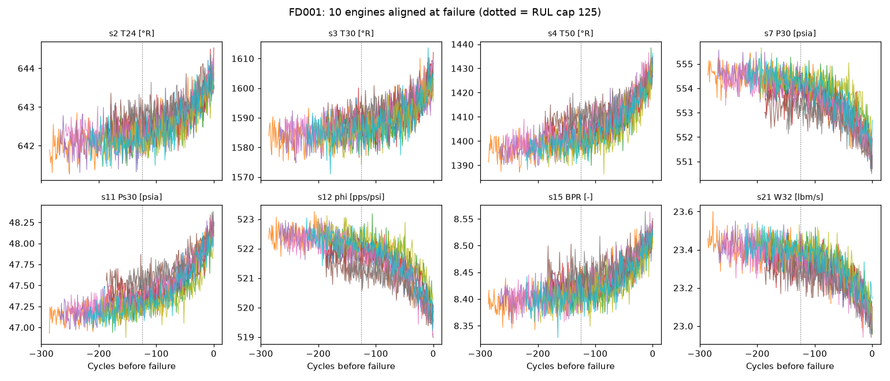
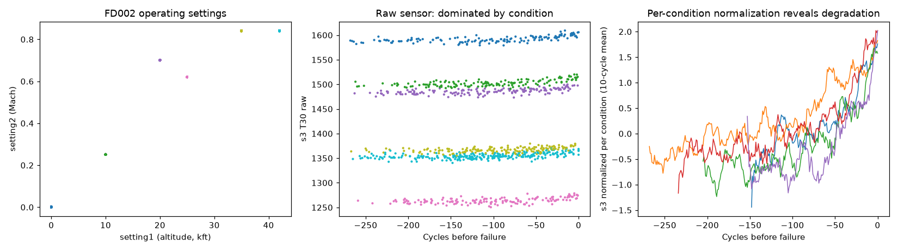
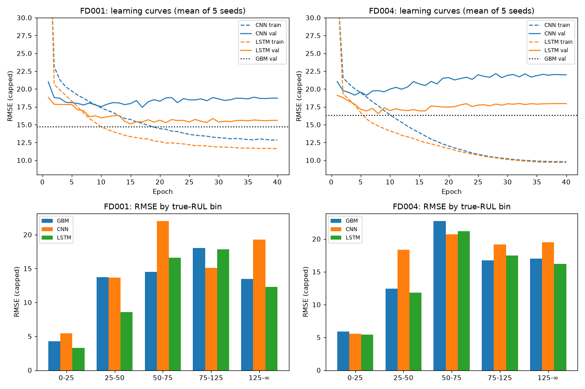
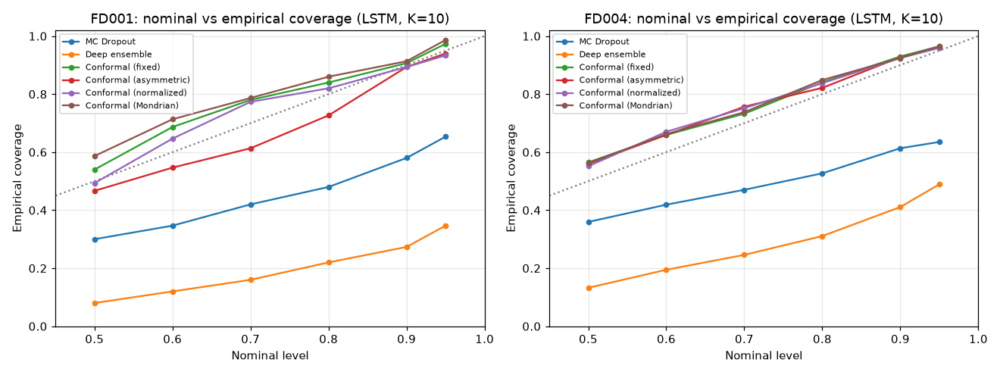
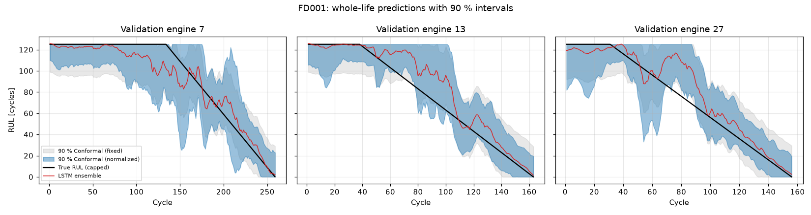
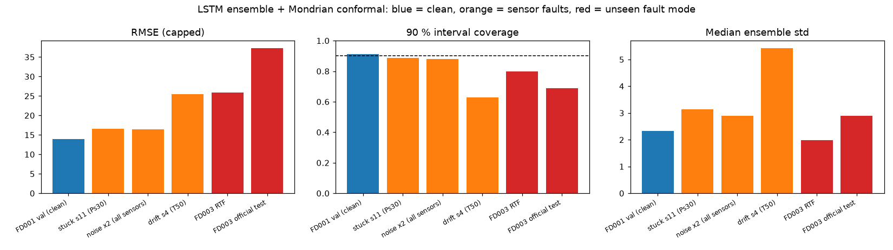
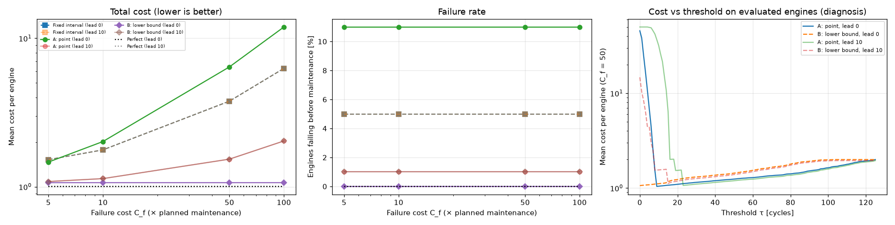

# 프로젝트 3. 장비 잔여수명(RUL) 예측 — 예측 구간이 약속한 확률만큼 맞는가

## 요약
NASA C-MAPSS 터보팬 엔진 데이터로 잔여수명(RUL)을 예측하고, **"90% 예측 구간"이 실제로 90%를 맞히는지**,
그리고 **그 구간이 정비 결정과 비용을 어떻게 바꾸는지** 검증했습니다.

| 질문 | 판정 | 핵심 근거 (공식 test는 마지막에 한 번만 사용) |
|---|---|---|
| H1. 딥러닝(1D-CNN)이 GBM보다 나은가? | ❌ 반증 | test RMSE: GBM 13.85 / LSTM 16.71 / CNN 18.71 (FD001). 원인: 실제 표본 크기는 겹치는 윈도우 수만 개가 아니라 **엔진 60~149대** → 과적합 |
| H2. MC Dropout·딥 앙상블 구간은 과신하는가? | ✅ 확인 | 90% 구간의 실제 적중률: 앙상블 **30~35%** (test), MC Dropout 58~61% (val) |
| H3. conformal은 평균 적중률은 지키지만 구간별로 다른가? | ✅ 확인 | 선택 방법의 test 적중률 **0.970 / 0.903**. 하지만 열화가 시작되는 RUL 50~75 구간은 0.73~0.88 |
| H4. 처음 보는 고장 모드에서 과신하는가? | ✅ 확인 | FD001 학습 → FD003 미지 모드 엔진 44대: 적중률 0.655, 위험 이탈 35%, **모델 분산은 오히려 감소** |
| H5. 구간 하한으로 정비하면 비용이 줄어드는가? | ⚠️ 조건부 | 리드타임 0: 비용 1.06배(완벽 예측 대비) vs 점 예측 2.0~11.9배. **이유는 정보가 아니라 기준값의 안정성.** 리드타임 10에서는 차이 없음 |

**가장 중요한 발견 두 가지**
1. **모델의 자기 확신에 안전을 맡기면 안 됩니다.** 처음 보는 고장 모드에서 모델은 더 확신하며 틀렸습니다.
   반면 모델 없는 **입력 범위 감시**(센서값이 학습 범위에서 4σ 이상 벗어나면 경보)는 FD001에서 오경보 0%로, 미지 모드 엔진의 고장 임박 구간을 100% 잡았습니다.
2. **conformal의 진짜 가치는 "정비 여유분을 통계적으로 정하는 것"입니다.** 점 예측 정책은 기준값이 몇 사이클만 어긋나도 고장이 폭증하는 절벽이 있었고,
   엔진 15대로 고른 기준값이 그 절벽에 걸려 고장 11건이 났습니다. 구간 하한 정책은 보정 데이터가 여유분을 정해 절벽을 피했습니다.

## 도메인 배경: 왜 방산에서 중요한가
| 개념 | 설명 |
|---|---|
| **PHM** | Prognostics and Health Management. 센서로 장비 상태를 보고 고장을 미리 예측하는 기술 |
| **RUL** | Remaining Useful Life. "앞으로 몇 사이클(비행 횟수) 더 쓸 수 있는가" |
| 정비 방식 | 사후 정비(고장 후 수리) → 예방 정비(정해진 주기마다 교체) → **예측 정비**(고장 직전에 정비) |
| **운용 가용도** | 보유 장비 중 즉시 출동 가능한 비율. 정비 중인 장비는 전투력이 아님 |
| **후속 군수지원 (ILS)** | 무기체계는 개발보다 수십 년간의 운용·유지 비용이 더 큼. 방산 기업은 납품 후에도 정비·부품으로 관여 |
| **성과기반 군수지원 (PBL)** | "부품 몇 개"가 아니라 "가동률 몇 %"로 계약. 고장을 미리 예측할수록 업체 이익 |
| 부품 조달 리드타임 | 군 부품은 주문 후 수개월이 걸리기도 함 → "최소한 언제까지 버티는가"(구간 하한)가 중요 |

C-MAPSS는 항공기 터보팬 엔진 시뮬레이션입니다. FD001은 고압 압축기(HPC) 열화 1종, FD003은 팬(Fan) 열화가 추가된 2종, FD004는 6개 운용 조건 + 2종입니다.

## 데이터
- 출처: NASA PCoE 데이터 저장소가 링크한 공식 파일. 크기와 SHA-256은 [EVALUATION.md](EVALUATION.md)에 기록했습니다. `data/`는 저장소에 넣지 않습니다.
- **문서와 다른 점:** FD004 엔진 수가 readme(248/249)와 실제 파일(249/248)에서 뒤바뀌어 있어 실제 파일을 기준으로 했습니다. readme의 "센서 26"은 실제로 21개입니다.
- **0단계 점검** ([data_report.md](results/data_report.md)): 결측 없음, 사이클 연속, 상수 센서 7개(FD001), 열화는 고장 약 100~150 사이클 전부터 뚜렷함.




## 평가 설계 (모델링 전에 고정)
전체 내용과 결과를 본 뒤 바꾼 점의 기록은 [EVALUATION.md](EVALUATION.md)에 있습니다.
- **엔진 단위 분할:** train 60% / val 15% / calib 25%. 같은 엔진이 두 분할에 섞이지 않게 했고, 정규화 통계는 train 엔진에서만 계산합니다.
- **공식 test는 마지막에 한 번만** 사용했습니다 ([final_test.md](results/final_test.md)).
- **test와 같은 형태의 평가:** val·calib 엔진을 임의 시점에서 잘라 "마지막 사이클 예측"을 만듭니다 (엔진당 10점).
- **레이블:** RUL 상한 125 (구간 선형). 예측 구간은 상한 적용 기준으로 평가합니다. 구간 상단 125는 "125 사이클 이상"으로 읽습니다.
- **선택 규칙 (사전 고정):** 점 예측은 val RMSE 최소, 구간은 "val 적중률 ≥ 88% 중 폭이 가장 좁은 것".

## 결과
### 2~3단계: 점 예측
| 모델 | FD001 val | FD001 **test** | FD004 val | FD004 **test** |
|---|---|---|---|---|
| GBM (윈도우 통계 특징) | 14.65 | **12.71** | 16.29 | 14.82 |
| LSTM (5시드 앙상블) | **13.97** | 15.81 | **15.80** | **14.60** |
| 1D-CNN (5시드 앙상블) | 16.58 | 17.38 | 18.29 | 19.25 |

(RMSE, 상한 적용 기준. 실제 RUL 기준 test RMSE: FD001 GBM 13.85, FD004 LSTM 26.54. FD004는 test 엔진 67대의 실제 RUL이 125를 넘음)

- **val과 test의 순위가 뒤집혔습니다** (FD001 LSTM ↔ GBM). val 엔진 15대에서의 차이는 짝지은 부트스트랩 신뢰구간이 0을 포함해 원래 통계적으로 구분되지 않았습니다.
- **CNN의 실패 원인:** 학습 오차는 40 에폭까지 계속 떨어지는데 val 오차는 6~17 에폭 이후 올라갑니다. 학습 윈도우는 1만~3만 개지만 같은 엔진의 윈도우는 거의 겹치므로, 독립 표본은 엔진 60~149대뿐입니다.
- FD004 조건별 정규화 효과: CNN val RMSE 22.27 → 18.29.



### 4단계: 90% 예측 구간
| 방법 | 원리 | FD001 test 적중률 | FD004 test 적중률 |
|---|---|---|---|
| 딥 앙상블 | 모델 5개의 의견 차이 | 0.300 | 0.351 |
| LSTM + conformal (고정 폭) | 보정 엔진에서 실제로 틀린 크기 측정 | 0.910 | 0.927 |
| LSTM + conformal (Mondrian) | 예측 RUL 구간별로 따로 측정 | 0.920 | **0.903** (선택) |
| GBM + conformal (Mondrian) | 같은 방식을 GBM에 적용 | **0.970** (선택) | 0.940 |

- **앙상블이 실패한 이유:** 모델끼리의 의견 차이만 재고, 센서 잡음이나 엔진별 초기 마모 같은 데이터 자체의 불확실성은 재지 못합니다. 모든 모델이 같이 모르는 것은 분산에 나타나지 않습니다.
- **이탈 방향을 나눠 보았습니다.** 실제 수명이 하한보다 짧으면 정비 전에 고장(위험)이고, 상한보다 길면 일찍 정비할 뿐(비용)입니다. 선택 방법의 위험 이탈은 test에서 2.0% / 6.0%입니다.
- **구간별 적중률:** 고장 임박(RUL < 25)은 거의 100%로 과잉 신중하고, 열화가 시작되는 RUL 50~75는 LSTM 기준 0.73~0.77로 미달입니다.
  원인으로 보이는 것은 "모든 엔진이 RUL 125에서 열화를 시작한다"는 레이블 가정입니다. 실제 열화 시작점은 엔진마다 다릅니다.




### 5단계: 센서 고장과 처음 보는 고장 모드
모델, 정규화, 보정은 모두 FD001에서 만든 것을 그대로 썼습니다.

| 상황 | LSTM RMSE | 앙상블 분산 | 적중률 (Mondrian) | 해석 |
|---|---|---|---|---|
| FD001 정상 | 14.0 | 2.32 | 0.913 | 기준 |
| s11(Ps30) 고착 | 16.5 | 3.14 | 0.887 | 비교적 견딤 |
| 전 센서 잡음 2배 | 16.4 | 2.90 | 0.880 | GBM은 21.6으로 더 취약 |
| s4(T50) 드리프트 | 25.4 | **5.43** | 0.627 (정규화 방식 **0.927**) | 분산이 커져 "모른다"는 신호를 냄 |
| FD003 FD001과 같은 패턴 (56대) | 14.5 | 2.40 | 0.911 | 아는 모드는 그대로 전이 |
| **FD003 처음 보는 패턴 (44대)** | **35.4** | **1.52** | **0.655** | **더 확신하며 틀림** |

- **미지 모드 찾기:** FD003에는 엔진별 고장 모드 정답이 없습니다. 처음에 s13 기준으로 나누려 했으나 FD003 100대 모두에서 같은 방향이라 실패했습니다.
  전 센서를 탐색해 보니, FD001 엔진 60대 모두 s7·s12·s20·s21이 하락하는데 FD003의 44대는 반대로 움직였습니다 (최대 +20σ).
- **입력 범위 감시 (모델 불필요, 기준값은 FD003을 보기 전에 고정):**

| 기준 \|z\| | FD001 오경보 | FD003 아는 패턴 | FD003 미지 패턴 (전체) | 미지 패턴, RUL ≤ 50 |
|---|---|---|---|---|
| 4 | **0.000** | 0.002 | 0.584 | **1.000** |
| 6 | 0.000 | 0.000 | 0.375 | 0.957 |



### 6단계: 정비 의사결정
FD001 엔진 100대를 5개 묶음으로 나누고, 각 묶음은 학습·보정·기준값 선택에 쓰지 않은 모델로만 평가했습니다.
비용 단위는 계획 정비 1회이고, 버린 수명은 평균 수명 대비 비율만큼, 정비 전 고장은 C_f로 계산합니다.

| 정책 | C_f = 50, 리드타임 0 | C_f = 50, 리드타임 10 | 고장 (리드타임 0 / 10) |
|---|---|---|---|
| 주기 정비 (현행 방식, 모델 없음) | 3.77 | 3.77 | 5 / 5 |
| A: 점 예측 ≤ τ | 6.42 | **1.53** | 11 / 1 |
| B: 구간 하한 ≤ τ | **1.06** | **1.53** | **0** / 1 |
| 완벽한 예측 (하한) | 1.005 | 1.005 | 0 / 0 |

- **예측 정비는 주기 정비보다 크게 낫습니다** (리드타임 10에서 비용 2.5배 차이, 고장 5 → 1).
- **사후 진단:** 기준값을 사후적으로 최적화하면 오히려 A가 조금 낫습니다 (1.040 vs 1.061). B가 이긴 이유는 더 좋은 정보가 아니라, A의 비용 곡선에 있는 **절벽**(τ가 8 아래로 내려가면 고장 폭증)을 B의 보정된 여유분이 피했기 때문입니다.
  A가 엔진 15대로 고른 τ = 4~9가 그 절벽에 걸렸습니다.



## 엔지니어링 메모
- **운용 조건 집계 버그:** 0에 가까운 설정값이 `-0.0`과 `0.0`으로 갈려, 조건 1개짜리 서브셋이 2개로 집계됐습니다. 수정 후 FD001·FD003은 1개로 정상 집계됩니다.
- **상수 센서 판정 오류:** 변동계수 기준은 평균이 2388 rpm인 팬 속도의 실제 추세를 "상수"로 잘못 판정했습니다. "조건 내 고유값 2개 이하" 기준으로 바꿨습니다.
- **pandas 3 호환:** 정수로 저장된 센서(s17)에 실수를 넣지 못해 정규화 전에 실수형으로 변환했습니다.
- **평가 지점 분포 문제:** 균일 절단에서는 RUL > 125인 초기 시점이 많아 실제 RUL 기준 RMSE와 NASA 점수가 그 점들에 지배됐습니다 (NASA 평균이 수백만). 선택 기준이 상한 적용 RMSE였기에 결론에는 영향이 없었습니다.
- **드라이런 수치 제거:** 1~2 에폭짜리 드라이런 집계 파일을 커밋 전에 지웠습니다.
- **고장 모드 추정 실패 후 재설계:** s13 가정이 틀린 것을 확인하고, 전 센서 탐색으로 s12 기준을 찾았습니다.
- **"너무 좋은 결과" 의심:** 6단계 첫 결과(B가 고장 0건, 1.06배)를 그대로 받아들이지 않고 사후 최적 기준값과 리드타임 분석으로 원인을 분리했습니다.

## 한계와 다음 단계
- **시뮬레이션 데이터:** 실제 군은 고장 전에 정비하므로 고장 시점을 모르는 데이터(중도 절단, censoring)가 대부분입니다. 생존 분석(survival analysis) 기반 접근이 필요합니다.
- **레이블 가정:** 열화 시작점을 모든 엔진 125로 고정했습니다. 엔진별 열화 시작점 추정이 RUL 50~75 구간의 적중률 미달을 개선할 수 있습니다.
- **작은 검증 세트:** 엔진 15대. 방법 간 차이 대부분이 통계적 잡음 범위 안에 있었고, val과 test 순위가 실제로 뒤집혔습니다.
- **비용 모델 단순화:** 실제 정비는 매 사이클이 아니라 점검 주기마다 결정하고, 정비 인력·부품 재고·임무 일정 제약이 있습니다.
- **감항인증:** 군용 항공기 정비 판단에 AI를 쓰려면 비행 안전성 인증 과정에서 검증 근거, 실패 모드 분석, 설명 가능성이 요구됩니다.

다음 단계 후보:
- [ ] 과적합 완화 (드롭아웃·가중치 감쇠, 엔진 단위 데이터 증강, 작은 모델)
- [ ] 엔진별 열화 시작점 추정 레이블
- [ ] 입력 범위 감시를 conformal과 결합한 "경보 시 구간 확대" 정책
- [ ] 중도 절단 데이터를 반영한 생존 분석 모델

## 파일 구성과 실행
| 파일 | 역할 |
|---|---|
| [data.py](data.py) / [inspect_data.py](inspect_data.py) | 데이터 로드, 0단계 점검 |
| [prep.py](prep.py) / [metrics.py](metrics.py) | 엔진 단위 분할·정규화·윈도우, 지표 |
| [baselines.py](baselines.py) | 2단계 베이스라인 |
| [models.py](models.py) / [train.py](train.py) / [run_step3.py](run_step3.py) / [monitor.py](monitor.py) | 3단계 학습 (분리 실행, 실시간 모니터) |
| [eval_step3.py](eval_step3.py) / [diagnose_step3.py](diagnose_step3.py) | 3단계 집계와 H1 진단 |
| [uq.py](uq.py) / [step4_val.py](step4_val.py) | 4단계 예측 구간 |
| [step5_shift.py](step5_shift.py) | 5단계 센서 고장·미지 고장 모드·입력 감시 |
| [step6_policy.py](step6_policy.py) | 6단계 정비 정책 |
| [final_test.py](final_test.py) | 공식 test 최종 평가 (1회) |
| [test_prep.py](test_prep.py) | 누수·윈도우·지표·conformal 테스트 7개 |

```bash
pip install -r requirements.txt
# C-MAPSS를 data/cmapss/ 에 풀기 (출처: EVALUATION.md)
python inspect_data.py && python test_prep.py
python baselines.py
python run_step3.py              # 25회 학습, 약 90분 (CPU). 진행 확인: python monitor.py
python eval_step3.py && python diagnose_step3.py
python step4_val.py && python step5_shift.py && python step6_policy.py
python final_test.py
```

## 면접에서 설명할 포인트
- **딥러닝이 GBM을 못 이겼는데요?** 표본 크기를 윈도우가 아니라 엔진 수로 봐야 한다는 진단과, 학습 곡선이라는 근거가 있습니다. val과 test 순위가 뒤집힌 것도 "작은 val 세트의 차이는 잡음"이라는 사전 진단과 일치합니다.
- **왜 앙상블 분산을 불확실성으로 쓰면 안 되나?** 모델 간 의견 차이만 재기 때문입니다. 90% 구간이 30%만 맞혔고, 처음 보는 고장 모드에서는 분산이 오히려 줄었습니다.
- **그럼 미지 상황은 어떻게 잡나?** 모델과 독립적인 입력 감시를 둡니다. 오경보 0%로 미지 모드의 고장 임박 구간을 100% 잡았습니다. 프로젝트 2와 대비하면, 새로움이 입력에 드러날 때는 이 방식이 통하고 표현에도 드러나지 않을 때는 통하지 않습니다.
- **conformal을 쓰면 정비 비용이 정말 줄어드나?** 조건부입니다. 줄어든 이유는 더 좋은 정보가 아니라 정비 여유분을 통계적으로 안정되게 정한 데 있습니다. 이 구분을 사후 진단으로 확인했습니다.
